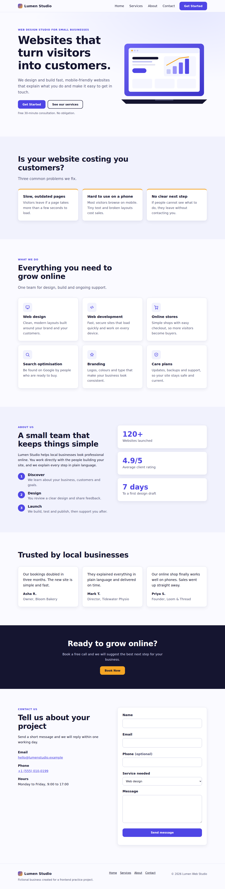

# Week-1-Assignment-BUSINESS-LANDING-PAGE.

### Objective
Design and build a modern, responsive business landing page using current layout techniques.

### Tech Stack
- HTML5
- Tailwind CSS (CDN)
- JavaScript
- Lucide Icons
- Google Fonts (Inter, JetBrains Mono)

### Features Implemented
- Responsive layouts using Flexbox and CSS Grid
- Desktop, tablet and mobile preview switching
- Hover and transition animations on buttons and cards
- Interactive code inspector with copy-to-clipboard
- Dark theme design system using CSS variables

### Live Link
https://claude.ai/artifact/4afC2FDV3Y2bzACxxuryZg
### Github Link 
https://psaikiran2002.github.io/Week-1-Assignment-BUSINESS-LANDING-PAGE./

### Screenshots

---
